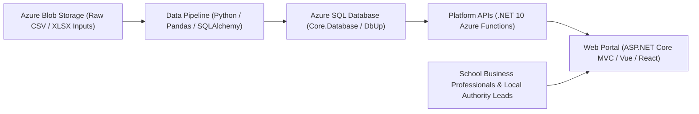

# Financial Benchmarking and Insights Tool: Architecture

## System Diagram

## Tech Stack

* **Core Infrastructure (`core-infrastructure/`)**: Terraform Infrastructure-as-Code (IaC) and .NET 8 DbUp SQL migration runner (`Core.Database`).
* **Data Pipeline (`data-pipeline/`)**: Python 3.13, Pandas, NumPy, PyArrow (Parquet), SQLAlchemy, PyODBC, and Azure Functions worker.
* **Platform API (`platform/`)**: .NET 10 isolated Azure Functions providing RESTful internal APIs.
* **Front-End Components (`front-end-components/`)**: React, TypeScript, and Vite component library.
* **Web Portal (`web/`)**: ASP.NET Core MVC application adhering to the GOV.UK Design System.

## Layers

1. **Ingestion and Pre-Processing Layer (`data-pipeline/src/pipeline/pre_processing/`)**: Reads raw Department for Education (DfE) statistical files from Azure Blob Storage (`default/{year}/...`), applies year-aware input schemas and column mappings (`input_schemas/`), transforms school (AAR/CFR) and Local Authority (S251) datasets, and writes intermediate Parquet files.
2. **Persistence Layer (`data-pipeline/src/pipeline/utils/database.py` & `core-infrastructure/src/db/Core.Database/`)**: Manages SQL schema evolution via numbered DbUp scripts (`Scripts/001-...` to `Scripts/140-...`) and executes bulk parameterised inserts into operational tables (`dbo.NonFinancial`, `dbo.LocalAuthorityNonFinancial`, etc.).
3. **Service Layer (`platform/`)**: Queries SQL tables and views to serve benchmarking and insight endpoints.
4. **Presentation Layer (`web/` & `front-end-components/`)**: Renders financial and non-financial comparisons for schools, trusts, and local authorities.

## Key Patterns

* **Year-Keyed Input Schemas**: Evolving input datasets use year-keyed schema dictionaries (`"default"` plus specific year overrides such as `2024`, `2025`, `2026`) in `data-pipeline/src/pipeline/input_schemas/`.
* **Ancillary Data Merging with Column Guarantees**: Optional or year-dependent ancillary datasets (such as DSG recoupment, High Needs places, and KS4 Local Authority benchmarks) use `ensure_*_columns_are_present` helpers so downstream DataFrame projections always find expected columns populated with `np.nan` when absent.
* **Idempotent DbUp Migrations**: Database schema changes use sequential SQL scripts guarded by `IF EXISTS` and `IF NOT EXISTS` metadata checks against `INFORMATION_SCHEMA`.

## Source Code Layout

* `core-infrastructure/src/db/Core.Database/Scripts/`: Sequential SQL migration scripts.
* `data-pipeline/src/pipeline/config/`: Database projection mappings and pipeline configuration.
* `data-pipeline/src/pipeline/input_schemas/`: Expected column names, pandas dtypes, and column rename maps per input source and year.
* `data-pipeline/src/pipeline/pre_processing/`: Domain transformation modules (`aar/`, `cfr/`, `ancillary/`, `s251/`, `bfr/`).
* `data-pipeline/src/pipeline/utils/database.py`: SQLAlchemy table insertion and projection functions.

## Data Flow

1. Pipeline receives a queue message containing `runType`, `runId`, and `year` dictionary (`aar`, `cfr`, `bfr`, `s251`).
2. `pre_process_ancillary_data` loads school-level ancillary datasets (`ks4.xlsx`, `census_pupils.csv`, `sen.csv`, etc.) and merges them onto academy and maintained school DataFrames by `URN`.
3. `get_s251_ancillary_data` loads Local Authority ancillary datasets (`dsg`, `place_numbers`, `ons`, `sen2`, and `ks4` for `s251_year >= 2026`) and merges them onto S251 Local Authority data by `old_la_code` (`LEA`).
4. `write_Result_data` writes Parquet outputs and invokes `database.py` functions (`insert_non_financial_data`, `insert_la_non_financial`, etc.) to persist projected columns into Azure SQL.

## Cross-Cutting Concerns

* **Data Integrity and Missing Values**: Suppressed or missing strings (`NP`, `NE`, `SUPP`, `LOWCOV`) are coerced to `NaN` during CSV/Excel loading, filled with `0.0` where required for present records, or persisted as SQL `NULL` (`np.nan` -> `None`) when an entity or dataset is absent.
* **Security**: Database operations use SQLAlchemy Core parameterised statements (`fast_executemany=True`) with zero string interpolation.

## ADRs

| ID | Title | Status | Date |
|----|-------|--------|------|
| [ADR-0001](decisions/ADR-0001-year-aware-ks4-attainment8-ingestion.md) | Year-Aware KS4 Input Schema and Conditional S251 Attainment 8 Extraction | Proposed | 2026-10-23 |
| [ADR-0002](decisions/ADR-0002-canonical-dataset-timeline-and-schema-normalisation.md) | Target-First Canonical Dataset Timeline and Step-Function Schema Normalisation | Proposed | 2026-10-30 |

## Assumptions

* [ASSUME-001: Historical KS4 Input Files Lack LA and Record Type Columns](assumptions/ASSUME-001-historical-ks4-schema-compatibility.md) (`validated`)
* [ASSUME-002: Attainment 8 Metrics Enable Meaningful Contextual Benchmarking](assumptions/ASSUME-002-attainment8-benchmarking-value.md) (`unresolved`)
* [ASSUME-003: DfE Dataset Schemas Evolve as a Forward Step-Function Across Reporting Years](assumptions/ASSUME-003-step-function-schema-inheritance-across-years.md) (`unresolved`)
