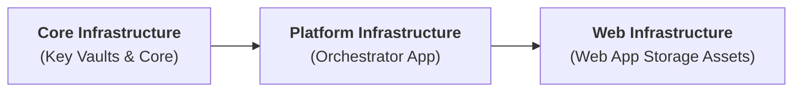

This document explains the infrastructure deployment sequencing, Key Vault reference resolution mechanics, and resilient error-handling strategies behind the Pipeline Orchestrator's storage configurations.

For specific configuration schemas and implementation detail, see the [Pipeline Orchestrator](/reference/orchestrator).

## 1. Infrastructure Deployment Sequencing

The infrastructure provisioning pipeline for the system follows a layered dependency chain:

1. **Core:** Establishes Key Vaults and storage accounts (including the `artifacts` blob container).
2. **Platform:** Provisions the Platform Orchestrator Azure Function App.
3. **Web:** Provisions frontend web application resources, including the web assets storage account behind Azure Front Door (containing the `files` container).

## 2. The Greenfield Provisioning Dilemma

During initial greenfield environment deployment, the Platform Function App requires knowledge of where to transfer generated post-processing artifacts (such as Local Authority Risk Score files).

Specifically, it needs two storage endpoints:

* **Source Endpoint:** The internal data storage account (`artifacts` container).
* **Destination Endpoint:** The web application storage account behind Azure Front Door (`files` container).

Because the destination web storage account is provisioned in the **Web** stage (Phase 3), its storage connection endpoint does not exist when Terraform executes the **Platform** stage (Phase 2).

If Terraform were configured to dynamically read the web storage account output during the Platform stage, deployment would fail due to missing resources.

## 3. Hardcoded Key Vault Reference Pattern

To bypass cross-pipeline deployment blocks, the Platform IaC module defines the `DestEndpoint` application setting using an explicit, hardcoded Key Vault secret URI rather than a dynamic Terraform resource lookup. This ensures that Terraform can successfully configure the Platform Azure Function App settings without requiring the destination resource to exist upfront.

**Transient Greenfield State:** Before the Web deployment finishes, the secret web-assets-storage-endpoint does not exist in Key Vault. If an invocation occurs in this window, URI parsing will fail gracefully, ensuring the trigger function is not blocked.

**Immediate Resolution:** The instant the Web deployment pipeline populates the secret in Key Vault, subsequent calls to App Settings resolve the URI to the actual storage endpoint string automatically. No further actions are necessary.
