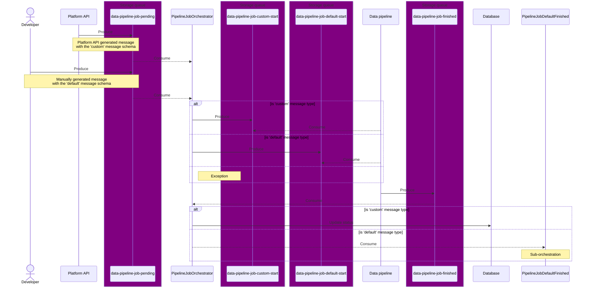
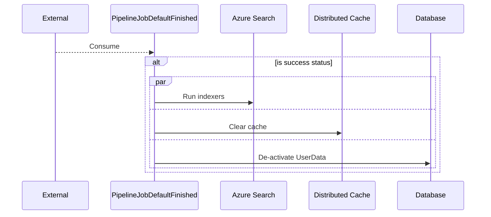

This document provides detailed information for developers about the implementation, usage and integration of the Pipeline Orchestrator feature within the system.

## Overview

The Pipeline Orchestrator manages the asynchronous execution lifecycle of background data processing jobs. Triggered via Azure Storage Queues (`JobPendingQueue`), it coordinates messaging between the Platform API, manual trigger payloads, and the Data Pipeline.

Upon receiving completion signals (`JobFinishedQueue`), the orchestrator performs state updates, triggers indexers, purges distributed caches, and handles secondary post-processing tasks such as transferring artifacts (e.g., Local Authority Risk Score files) to storage containers accessible by the web app behind Azure Front Door.

For a deeper dive into trigger parameter mechanics, correlation tokens (`jobId`), and run types (`runId`), see the [Pipeline Trigger Message Concepts](/explanation/pipeline-trigger-message) explanation guide.

## Orchestrations

### PipelineJobOrchestrator



### PipelineJobDefaultFinished



## Storage & Artifact Handling

### Current Implementation (LAA Risk Score Blob Transfer)

When a default pipeline job finishes successfully (`job.Success == true` and `job.DeriveLaaRiskScores == true`), the function `PipelineJobFinished` copies the generated Local Authority Risk Score CSV file from an internal staging container (`artifacts`) to a destination container (`files`) accessible to the web application behind Azure Front Door.

**Retention Behavior:** The source file is retained in the artifacts container to serve as a historical audit record. The operation acts as a publish/copy step rather than a destructive move.

**Execution Pattern:** The blob is read into memory via streaming (OpenReadAsync) and written directly to the destination (UploadAsync).

**Fault Tolerance Strategy:** File relocation is treated as a secondary non-blocking operation. If blob storage access fails or configuration is missing, the error is logged, database detail updates are skipped, but the primary pipeline job orchestration is permitted to finish successfully.

### Future Storage Expansion & Scaling Considerations

**Extending Storage Workflows (Upcoming Artifacts):** The current `IBlobStorageService` and move task pattern can be reused or expanded to support additional pipeline artifact operations:

- **Sitemap Generation & Transfer:** Moving dynamically generated `sitemap.xml` files from data execution output directly into web-app storage behind Front Door.
- **Data Pipeline Transparency Files:** Publishing transparency files generated as data pipeline run artifacts into web-app storage behind Front Door.

**Payload Memory Limits:** The current streaming approach (`OpenReadAsync` -> `UploadAsync`) routes all file bytes through the Azure Function worker's memory space. This mechanism is designed for CSV files under 100 MB.

**Large File Refactoring (>100 MB):** If future pipeline output files exceed 100 MB, this transfer implementation should be refactored to use asynchronous server-side copying via the Azure Blob Storage API (`StartCopyFromUriAsync`) or offloaded to a dedicated activity task to prevent worker memory exhaustion.

**Orchestration Retries:** Moving secondary side effects into dedicated Durable Activity tasks with retry policies will improve fault tolerance without placing direct burden on the queue trigger function worker.

## Configuration

Configuration settings for storage operations are bound via `IOptions<StorageOptions>` under the StorageSettings section.

For local development using **Azurite** (Azure Storage Emulator), use the well-known local endpoints:

```json
{
  "StorageSettings": {
    "LaaRiskFiles": {
      "SourceEndpoint": "UseDevelopmentStorage=true",
      "DestEndpoint": "UseDevelopmentStorage=true",
      "SourceContainer": "artifacts",
      "DestContainer": "files"
    }
  }
}
```

Note: `BlobServiceClientFactory` checks if the endpoint string starts with `UseDevelopmentStorage=true`. If so, it initializes the client directly against the local Azurite emulator without attempting Azure Managed Identity.

## Known Issues

### Greenfield Deployment Sequencing & Key Vault Reference Resolution

During environment provisioning, infrastructure modules are applied in a strict dependency sequence:

1. Core Infrastructure (creates shared Key Vaults & storage)
2. Platform Infrastructure (deploys Orchestrator Function App)
3. Web Infrastructure (creates storage container accessible by the web app via Front Door & updates secret values)

Because the destination storage resource is created late in the deployment cycle (Phase 3), the secret URI for web-assets-storage-endpoint cannot be evaluated as a Terraform data object lookup during Phase 2. To avoid deployment circular dependencies, the destination endpoint App Setting is constructed using a hardcoded Key Vault secret path reference:

### Runtime Impact & Secret Resolution

- **Unpopulated Secret Window:** If an orchestration job runs after Platform deployment completes but before Web deployment finishes, the App Service Key Vault reference will fail to resolve. BlobServiceClientFactory will catch the unresolved URI or auth failure, log the exception, skip writing LAA details to the database, and allow the core pipeline job to complete.

- **Automatic Resolution:** As soon as the Web layer finishes deployment and populates the Key Vault secret, Azure App Service resolves the Key Vault reference immediately on subsequent function invocations without requiring a Function App restart or manual configuration sync.

For an in-depth explanation of this deployment sequence pattern and its operational tradeoffs, see the [Pipeline Orchestrator Deployment & Secret Resolution](/explanation/pipeline-orchestrator-deployment-and-secrets) explanation guide.
